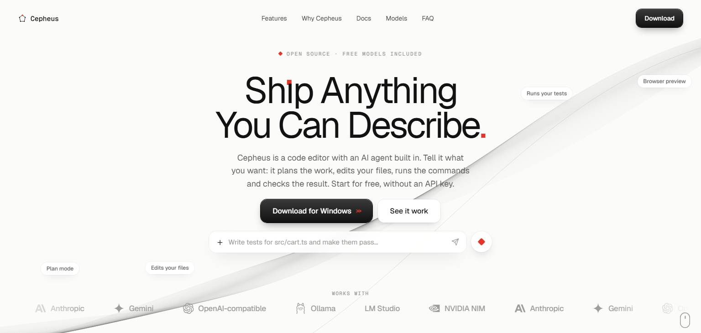
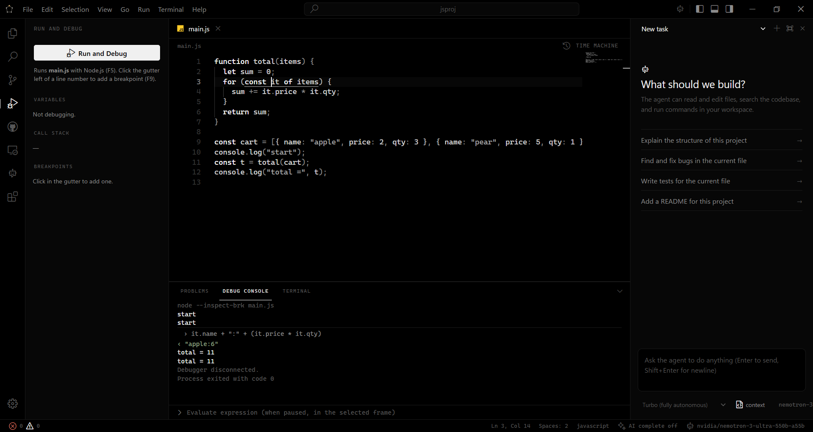
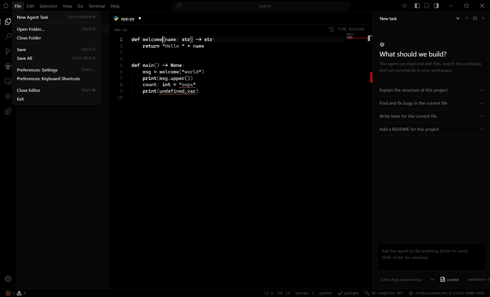
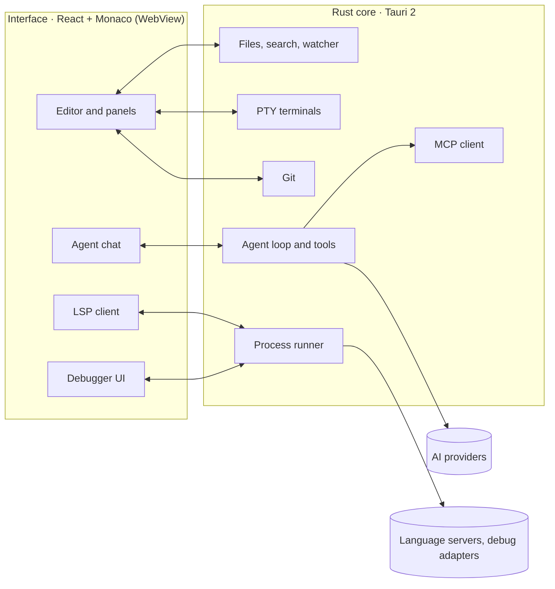

<div align="center">


# Cepheus IDE

**Ship anything you can describe.**

A lightweight code editor with a built-in AI agent that plans the work, edits your files,<br>runs the commands and checks the result. Free models included. Open source.

[](https://github.com/Cepheus-IDE/Cepheus/actions/workflows/build.yml)
[](LICENSE)


[Download](#-download) · [Quick start](#-quick-start) · [Features](#-features) · [Docs](landing/docs.html) · [Build from source](#-build-from-source) · [Contributing](#-contributing)

<br>



</div>

<br>

## Table of contents

- [Why Cepheus](#-why-cepheus)
- [Download](#-download)
- [Quick start](#-quick-start)
- [Features](#-features)
- [AI models](#-ai-models)
- [Customize the agent](#-customize-the-agent)
- [Keyboard shortcuts](#-keyboard-shortcuts)
- [Build from source](#-build-from-source)
- [Releasing](#-releasing)
- [Architecture](#-architecture)
- [Project structure](#-project-structure)
- [Security and privacy](#-security-and-privacy)
- [Roadmap](#-roadmap)
- [Contributing](#-contributing)
- [License](#-license)

<br>

## ✦ Why Cepheus

| | |
|---|---|
| **An agent that finishes the job** | It plans, edits, runs your tests and fixes what fails, while you watch every step and approve what matters. |
| **Free to start** | Free NVIDIA Nemotron models are built in. No account, no API key, no trial. |
| **Small and native** | The core is a Rust program on Tauri 2. It uses the system web view instead of bundling a browser. |
| **A real editor** | Language servers, a debugger, a test explorer, a three-way merge editor and an integrated browser ship in the box. |
| **Yours to change** | MIT licensed. No telemetry. Your API keys never leave your machine except to the provider you choose. |

**Measured on Windows 11:** the Rust core used **10 MB** of private memory, and the first release program was **9.2 MB**. The interface runs in WebView2, whose memory grows with the files, terminals and previews you open.

<br>

## ⬇ Download

Installers for every platform are built by GitHub Actions and published on the [Releases](https://github.com/Cepheus-IDE/Cepheus/releases) page.

| Platform | File | Notes |
|---|---|---|
| **Windows 10 / 11** (64-bit) | `Cepheus IDE_x.y.z_x64-setup.exe` | WebView2 is part of Windows 11; the installer adds it on Windows 10. |
| **macOS 11+** (Intel and Apple Silicon) | `Cepheus IDE_x.y.z_universal.dmg` | One universal app for both chip types. |
| **Linux** | `.deb`, `.rpm`, `.AppImage` | Debian/Ubuntu, Fedora/openSUSE, or any distribution. |

> [!NOTE]
> Builds are not code-signed yet. On Windows, SmartScreen may show **"Windows protected your PC"**: choose **More info › Run anyway**. On macOS, right-click the app and choose **Open** the first time.

<br>

## ⚡ Quick start

1. **Install** Cepheus and open it.
2. **Open a folder** with <kbd>Ctrl</kbd>+<kbd>O</kbd> (or **File › Open Folder…**).
3. **Ask the agent.** Press <kbd>Ctrl</kbd>+<kbd>L</kbd> and describe what you want, for example:
   > *Add input validation to the signup form and make sure the tests pass.*
4. **Review.** Approve edits and commands as they come, then **Keep** or **Revert all** from the Changes list.

The agent starts on the free NVIDIA models. Install [Git](https://git-scm.com) to use source control features.

<br>

## ✦ Features



### 🤖 AI agent

| Feature | What it does |
|---|---|
| **Agent panel** <kbd>Ctrl</kbd>+<kbd>L</kbd> | Explores the codebase, edits files and runs commands in your project. |
| **Approval modes** | **Ask** before every edit and command, **Auto-edit** (ask only for commands), or **Turbo** (fully autonomous). |
| **Plan mode** | Read-only research and a step checklist first, then **Start implementation** in the same conversation. |
| **Steer mid-run** | Keep typing while it works; messages are queued and added before its next step. |
| **Verify with checks** | Runs your `typecheck` / `lint` / `test` scripts, `cargo check`, `go test` or `pytest` when it finishes, and fixes failures for up to three rounds. |
| **Changes list** | Every file it touched, with diffs, **Keep** and **Revert all**. |
| **Agent Manager** <kbd>Ctrl</kbd>+<kbd>Shift</kbd>+<kbd>M</kbd> | Run several tasks in parallel and watch their status. Sessions are saved across restarts. |
| **Debug log** | Each model turn, tool call, token count and hook, as a timeline and flow summary. |
| **Inline edit** <kbd>Ctrl</kbd>+<kbd>K</kbd> | Rewrite the selection from an instruction. |
| **AI inline completion** | Optional ghost-text suggestions while you type. |
| **AI commit messages and review** | Generate a commit message, or get a code review of your uncommitted changes. |

### ✍️ Editing

| Feature | What it does |
|---|---|
| **Monaco editor** | Syntax highlighting for ~80 languages, minimap, sticky scroll, bracket colors, multi-cursor. |
| **Language servers** | Completion, hover, go to definition <kbd>F12</kbd>, references <kbd>Shift</kbd>+<kbd>F12</kbd>, rename <kbd>F2</kbd> for Python, Rust, Go, C/C++, Java, PHP, Ruby, Lua, C#, Bash, YAML and Dockerfile. One-click install when a server is missing. |
| **Quick fixes and refactors** | Lightbulb <kbd>Ctrl</kbd>+<kbd>.</kbd>, Refactor <kbd>Ctrl</kbd>+<kbd>Shift</kbd>+<kbd>R</kbd>, Organize Imports <kbd>Shift</kbd>+<kbd>Alt</kbd>+<kbd>O</kbd>, extract function/constant for TS/JS. |
| **Problems panel** | Errors and warnings across the workspace, including files that aren't open. |
| **Snippets** | VS Code format with tab stops and variables (`$TM_FILENAME`, `$CURRENT_YEAR`, `$CLIPBOARD`…). |
| **Search** | Across files with regex, match case and whole word; replace all; respects `.gitignore`. |
| **Terminal** | Real PTY with tabs and splits <kbd>Ctrl</kbd>+<kbd>\\</kbd>; PowerShell, pwsh, cmd, Git Bash, WSL, bash or zsh; <kbd>Ctrl</kbd>-click file paths in the output. |
| **Time Machine** <kbd>Ctrl</kbd>+<kbd>Alt</kbd>+<kbd>H</kbd> | Every saved and agent-edited version of a file, with diff and restore. |



### 🐞 Debugging and testing

| Feature | What it does |
|---|---|
| **Node.js / TypeScript debugger** <kbd>F5</kbd> | Breakpoints, step over/into/out, variables, call stack, watch expressions, inline values and a debug console. |
| **Breakpoint types** | Conditional, hit count and logpoints; enable, disable or deactivate all. |
| **Launch configurations** | `.vscode/launch.json` or `.cepheus/launch.json` with `${workspaceFolder}`-style variables; attach by port. |
| **Python** | Through debugpy (`pip install debugpy`), using the same UI. |
| **Test Explorer** | Vitest, Jest, `node --test`, pytest, cargo test and go test. Run or debug all, a file or one test. |
| **In the editor** | ✓ / ✗ marks, failure messages at the assertion, coverage overlays and watch mode. **Fix with Agent** on a failure. |

### 🌿 Git and GitHub

| Feature | What it does |
|---|---|
| **Changes** | Stage files or single hunks from the gutter, commit with amend and sign-off, undo last commit, stash, Sync. |
| **Merge conflicts** | Accept current / incoming / both inline, or resolve in a three-way merge editor. |
| **History** | A commit graph with search, commit details, and a Timeline of git and local history per file. |
| **Branches and tags** | Checkout, create, rename, delete, merge, rebase; quick branch picker from the status bar. |
| **GitHub** | Clone and publish repositories; review, comment on, approve and merge pull requests; turn issues into agent tasks. |
| **Apple apps without a Mac** | Build iOS and macOS apps (Xcode, SwiftPM, Flutter, React Native, Expo, Tauri, Capacitor, KMP, .NET MAUI) on GitHub-hosted macOS runners: generate the workflow, run it, watch the logs and download the artifacts. Expo Go preview by QR code. Real-device, TestFlight and App Store builds need an Apple Developer account and signing secrets. |

### 🌐 Browser, remote and containers

| Feature | What it does |
|---|---|
| **Browser preview** | Dev servers open in a tab beside the code, with device sizes, DevTools, a console and live reload. |
| **Share with Agent** | Send the page's text, structure and console errors to the agent; it can also open, read and click the page itself. |
| **Remote SSH** | Open a folder on another machine. Files, terminals, git, search and the agent run there. |
| **Dev Containers** | **Reopen in Container** when the project has `.devcontainer/devcontainer.json` and Docker is installed. |

### 🎨 Make it yours

| Feature | What it does |
|---|---|
| **Themes** | Ink, Graphite, Noir, Moss, Paper, two high-contrast themes, and **Theme Studio** to design your own. |
| **Extensions** | Color themes (incl. high contrast), file icon themes, snippets, TextMate language grammars and editing rules, keymaps (Sublime, Atom, IntelliJ …) and extension packs from [Open VSX](https://open-vsx.org). Featured collections, categories, sorting, compatibility badges, version picker, bulk / auto update. No extension code is executed. |
| **Import** | Settings, themes and snippets from VS Code, Cursor, Windsurf or VSCodium. |
| **Settings** | UI or JSON, with user and workspace levels and schema completion. |
| **Keyboard shortcuts** | Remap any command, Sublime-like or JetBrains-like presets, export a printable list. |
| **Profiles and Settings Sync** | Bundle settings, shortcuts, extensions, snippets and layout; sync through a private GitHub Gist. |
| **Zoom** | <kbd>Ctrl</kbd>+<kbd>=</kbd> / <kbd>Ctrl</kbd>+<kbd>-</kbd> / <kbd>Ctrl</kbd>+<kbd>0</kbd>. |

### 🗄 Database

A database client built into the editor, for **PostgreSQL, MySQL, MariaDB, SQLite and SQL Server**.

| Feature | What it does |
|---|---|
| **Connections** | Direct or through an SSH tunnel; passwords in the system keychain; color tags; production connections are read-only until you confirm. |
| **Explorer and SQL editor** | Databases, schemas, tables, views and functions; schema-aware autocomplete; run all or a selection; EXPLAIN; history; multiple result sets. |
| **Data grid** | Paging, sorting, filters, inline edits saved in one transaction with the SQL shown first; export to CSV, JSON or SQL; CSV import. |
| **Table designer and ER diagram** | Design columns, indexes and foreign keys with a DDL preview; see every relationship on a draggable ER diagram. |
| **Agent** | Ask it to design a schema ("tables for a blog with users, posts and comments"); it shows the DDL and runs it after you approve. |
| **Safety** | `DROP`, `TRUNCATE` and `DELETE`/`UPDATE` without `WHERE` always need a typed confirmation. |

### 🐳 Docker

Containers, compose projects, images, volumes and networks in one view: start, stop and restart, live logs, a shell inside a container, stats, image pull/build/run, and cleanup with clear confirmations. Works with Docker Desktop, Docker Engine or Podman.

### 🧩 Extension bridges

Extensions from Open VSX that would need VS Code's extension host are connected to real features instead:

- **Claude Code** and **Codex** become the agent in the chat panel.
- **Formatters** (Prettier, Black, Ruff, rustfmt, gofmt, clang-format, shfmt and more) and **linters** (ESLint, Ruff, Stylelint, ShellCheck, markdownlint, Hadolint) run through their command-line tools.
- **Language servers** bundled with YAML, Prisma, GraphQL, Svelte, Astro and Tailwind CSS extensions run as real servers.
- **EditorConfig**, inline error messages, path completion and auto-rename of HTML tags are built in.
- Extensions whose features Cepheus already has (GitLens, Live Server, Docker, Python, Remote SSH…) point you to them.

### 🧰 Toolbox

Small tools that save time every day, in the **Toolbox** view and the **Tools** menu.

| Tool | What it does |
|---|---|
| **Ports** | See what is listening on every port, open it in the browser, or stop the process. When a command fails with "port already in use", Cepheus offers to free it. |
| **.env manager** | Masked values, keys used in code but missing from `.env`, and `.env` / `.env.example` kept in step. |
| **Secret guard** | Scans staged changes before every commit for API keys, tokens, private keys and staged `.env` files, and stops the commit until you confirm. |
| **Presentation mode** | Blurs `.env` values and secret-looking strings in every editor while you share your screen. |
| **Scripts** | One-click runs for package.json scripts, Makefile, justfile, Cargo, Composer, Python and Docker Compose tasks, with favorites and last exit code. |
| **Disk sweeper** | Finds heavy rebuildable folders (`node_modules`, `target`, `.next`, `.venv`, `DerivedData`…) across your projects and moves the ones you pick to the trash. |
| **TODO tree** | Every TODO, FIXME, HACK and NOTE in the workspace, grouped by file. |
| **Explain this error** | When a terminal command fails, send the last lines to the agent with one click. |
| **Dev utilities** | JSON ⇄ YAML ⇄ TOML, JWT decoder, Base64/URL, UUID v4/v7, timestamps, regex tester, color converter, hashes, text diff and a cron explainer. |
| **Clipboard history** | The last 50 copies made in the editor, searchable, with <kbd>Ctrl</kbd>+<kbd>Shift</kbd>+<kbd>V</kbd>. Kept in memory only. |

### 🧠 Skills

A **Skills** view with a gallery of 26 ready-made skills (tests, code review, security and accessibility audits, i18n, Docker, CI, release notes and more), one-click install per project or for your user, an editor to write your own, "Create skill from this conversation", and import/export as `.cepheus-skill` files.

### 🏢 For teams

A system policy file (`%ProgramData%\Cepheus\policy.json`, `/Library/Application Support/Cepheus/policy.json` or `/etc/cepheus/policy.json`) can lock settings and limit providers, models, agent tools and MCP servers, set the minimum approval mode, add shared agent instructions, allow only approved extensions, and configure a proxy, trusted certificates and the update mode. See [the docs](landing/docs.html#teams).

<br>

## 💻 CLI and Web

**CLI.** The same agent in your terminal, published on npm as [`cepheus-ide`](https://www.npmjs.com/package/cepheus-ide):

```bash
npm i -g cepheus-ide
cepheus                       # interactive session in the current folder
cepheus "fix the failing test" # one task, then exit
cepheus web .                 # the full editor in your browser for this folder
```

It supports plan mode, approvals, AGENTS.md, skills, hooks and MCP servers, `/undo` and `/diff`, and `--json` output for scripts. See [cli/README.md](cli/README.md).

**Web.** Open **[cepheus.codes/app](https://cepheus.codes/app/)** in Chrome or Edge to work on a local folder in the browser (editor, search and agent; no terminal). For everything including terminals, Git and language servers, run `cepheus web` on your machine or server and open the printed address.

## 🧠 AI models

Pick a model in the chat footer or open **Chat: Manage Language Models…** from the Command Palette.

| Provider | What you need |
|---|---|
| **NVIDIA (free, default)** | Nothing. Nemotron 3 Ultra, Nemotron 3.5 Lightning and Nemotron 3.5 Super VL. Add your own `nvapi-…` key for higher limits. |
| **Anthropic Claude** | An API key from console.anthropic.com. |
| **Google Gemini** | An API key from aistudio.google.com. |
| **OpenAI-compatible** | Base URL and key for OpenAI, OpenRouter, Groq and others. Add as many named providers as you like. |
| **Ollama / LM Studio** | A local server such as `http://localhost:11434/v1`. No key and no internet needed. |
| **Claude Code / Codex** | Use their CLIs as the agent harness when they are installed. |

**Auto** picks a model per request and moves to the next one on rate limits, server errors, timeouts or "not found". Thinking effort can be set for models that support it.

<br>

## 🛠 Customize the agent

Cepheus reads these from the root of your project:

| Path | Purpose |
|---|---|
| `AGENTS.md`, `CLAUDE.md`, `.github/copilot-instructions.md` | Instructions added to every run. |
| `.cepheus/instructions/*.md` | More instructions; limit them to paths with `applyTo: "src/**/*.ts"` frontmatter. |
| `.cepheus/skills/<name>/SKILL.md` | Reusable procedures the agent loads on demand. |
| `.cepheus/agents/<name>.md` | Custom agents with their own instructions, tool allowlist and model. |
| `.cepheus/hooks.json` | Commands that run on `preToolUse`, `postToolUse` or `stop`; a failing `preToolUse` hook blocks the call. |
| `.cepheus/mcp.json` | MCP servers (stdio `command` or HTTP `url`) whose tools the agent can use. |
| `.cepheus/settings.json` | Editor and appearance overrides for this project. |

<details>
<summary><b>Example: a read-only reviewer agent</b></summary>

```markdown
---
name: reviewer
description: Reviews changes without editing files
tools: [list_dir, find_files, read_file, search, run_command]
---
Review the uncommitted changes. Report bugs by severity with file:line.
```
</details>

<details>
<summary><b>Example: block dangerous commands with a hook</b></summary>

```json
{
  "hooks": [
    { "event": "preToolUse", "matcher": "run_command", "command": "node scripts/check-command.js" },
    { "event": "stop", "command": "npm run lint" }
  ]
}
```
</details>

<details>
<summary><b>Example: connect an MCP server</b></summary>

```json
{
  "servers": {
    "github": { "command": "npx", "args": ["-y", "@modelcontextprotocol/server-github"], "env": { "GITHUB_TOKEN": "…" } },
    "docs":   { "url": "https://example.com/mcp" }
  }
}
```
</details>

Full reference: [landing/docs.html](landing/docs.html).

<br>

## ⌨ Keyboard shortcuts

| Action | Shortcut | Action | Shortcut |
|---|---|---|---|
| Command Palette | <kbd>Ctrl</kbd>+<kbd>Shift</kbd>+<kbd>P</kbd> | Agent panel | <kbd>Ctrl</kbd>+<kbd>L</kbd> |
| Go to file | <kbd>Ctrl</kbd>+<kbd>P</kbd> | New agent task | <kbd>Ctrl</kbd>+<kbd>Shift</kbd>+<kbd>N</kbd> |
| Open folder | <kbd>Ctrl</kbd>+<kbd>O</kbd> | Agent Manager | <kbd>Ctrl</kbd>+<kbd>Shift</kbd>+<kbd>M</kbd> |
| Save / Save all | <kbd>Ctrl</kbd>+<kbd>S</kbd> / <kbd>Ctrl</kbd>+<kbd>Alt</kbd>+<kbd>S</kbd> | Inline AI edit | <kbd>Ctrl</kbd>+<kbd>K</kbd> |
| Search in files | <kbd>Ctrl</kbd>+<kbd>Shift</kbd>+<kbd>F</kbd> | Quick fix | <kbd>Ctrl</kbd>+<kbd>.</kbd> |
| Source control | <kbd>Ctrl</kbd>+<kbd>Shift</kbd>+<kbd>G</kbd> | Go to definition | <kbd>F12</kbd> |
| Run and Debug | <kbd>Ctrl</kbd>+<kbd>Shift</kbd>+<kbd>D</kbd> | Rename symbol | <kbd>F2</kbd> |
| Start / continue debugging | <kbd>F5</kbd> | Toggle breakpoint | <kbd>F9</kbd> |
| Step over / into / out | <kbd>F10</kbd> / <kbd>F11</kbd> / <kbd>Shift</kbd>+<kbd>F11</kbd> | Toggle terminal | <kbd>Ctrl</kbd>+<kbd>`</kbd> |
| Toggle sidebar | <kbd>Ctrl</kbd>+<kbd>B</kbd> | Settings | <kbd>Ctrl</kbd>+<kbd>,</kbd> |

Every shortcut can be changed in **Preferences: Keyboard Shortcuts**.

<br>

## 🔧 Build from source

### Requirements

| | |
|---|---|
| **All platforms** | [Node.js](https://nodejs.org) 18+, [Rust](https://rustup.rs) stable, [Git](https://git-scm.com) |
| **Windows** | Visual Studio Build Tools with the **Desktop development with C++** workload |
| **macOS** | Xcode Command Line Tools: `xcode-select --install` |
| **Linux (Debian/Ubuntu)** | `sudo apt install libwebkit2gtk-4.1-dev libappindicator3-dev librsvg2-dev patchelf libssl-dev` |

### Run and build

```bash
git clone https://github.com/Cepheus-IDE/Cepheus.git
cd Cepheus
npm install
npm run app:dev     # the app with hot reload
npm run app:build   # installers in src-tauri/target/release/bundle/
```

| Command | What it does |
|---|---|
| `npm run dev` | Frontend only, in the browser at `localhost:1420` (no native features). |
| `npm run app:dev` | Full app with hot reload for the frontend and rebuilds for Rust changes. |
| `npm run build` | Type-check and build the frontend into `dist/`. |
| `npm run app:build` | Release build and installers for the current platform. |

### Free NVIDIA models

The built-in free access needs an NVIDIA API key **at build time**. Put it in `src-tauri/nvidia.key` (git-ignored) or set the `NVIDIA_API_KEY` environment variable. Without it the app still works; users add their own key in Settings.

> [!WARNING]
> A key compiled into the app can be extracted by anyone who downloads it, and all users share its rate limit. For public releases, consider routing requests through a small proxy server that holds the key.

<br>

## 🚀 Releasing

[`.github/workflows/build.yml`](.github/workflows/build.yml) builds on every push and pull request to `main`, and uploads the installers as workflow artifacts. To publish a release:

```bash
# bump "version" in src-tauri/tauri.conf.json and package.json, then:
git tag v0.2.0
git push origin v0.2.0
```

The workflow builds Windows (NSIS), macOS (universal `.app` + `.dmg`) and Linux (`.deb`, `.rpm`, `.AppImage`) and attaches them to a **draft release** for you to review and publish. Add the repository secret `NVIDIA_API_KEY` to include the free models in those builds.

<details>
<summary><b>Turning on auto-updates</b></summary>

1. Generate a signing key: `npx tauri signer generate -w ~/.tauri/cepheus.key` (keep the private key and password secret).
2. Put the public key in `src-tauri/tauri.conf.json` → `plugins.updater.pubkey` and the feed URL in `endpoints`, for example `https://github.com/Cepheus-IDE/Cepheus/releases/latest/download/latest.json`.
3. Add `"createUpdaterArtifacts": true` under `bundle`.
4. Add `TAURI_SIGNING_PRIVATE_KEY` and `TAURI_SIGNING_PRIVATE_KEY_PASSWORD` as repository secrets and pass them to the build step.
</details>

<br>

## 🏗 Architecture



The interface talks to the Rust core through Tauri commands and events. The agent loop, tools, MCP client and provider adapters all run in Rust; language servers and debug adapters are child processes spoken to over stdio.

<br>

## 📁 Project structure

```
src-tauri/src/                Rust core
  lib.rs                      command registration and app setup
  agent/                      agent loop, tools, providers, MCP, skills/hooks, persistence, checks
  fs_cmds.rs, vfs.rs          file system (local and ssh://)
  search.rs, watcher.rs       search across files, file watcher
  terminal.rs, procs.rs       PTY terminals, stdio process runner (LSP / DAP framing)
  git.rs, history.rs          git integration, local file history
  ssh.rs, devcontainer.rs     Remote SSH, Dev Containers
  browser.rs                  integrated browser and static preview server
  harness.rs                  Claude Code / Codex as agent harnesses
  ext.rs                      Open VSX extensions, VS Code import
  profiles.rs, sync.rs        profiles, Settings Sync
  policy.rs, net.rs           organization policy, proxy and certificates
  updater.rs, continuity.rs   auto-update, deep links, single instance
src/                          React interface
  components/                 editor, panels, agent chat, debugger, testing, git, browser, settings
  lib/                        API wrappers, LSP and DAP clients, agent client, models, git, testing
landing/                      the website (index, why, docs)
.github/workflows/            cross-platform builds and releases
```

<br>

## 🔒 Security and privacy

- **No telemetry.** Cepheus does not report usage anywhere.
- **Keys stay local.** API keys are stored in your user config folder and sent only to the provider you selected. Profiles and Settings Sync strip keys and tokens.
- **The agent is confined** to the open workspace folder, and in **Ask** mode every file write and command needs your approval. Every agent change can be reverted.
- **Repositories can't take over.** A project's `.cepheus/settings.json` may only change editor and appearance settings, never commands, language servers, providers or approval mode.
- **Deleting from the explorer** moves files to the Recycle Bin or Trash.
- Extensions from Open VSX provide declarative data only (themes, icons, snippets, grammars, language rules, keymaps); no extension code runs.

Found a vulnerability? Please open a private security advisory on GitHub instead of a public issue.

<br>

## 🗺 Roadmap

- [ ] Code-signed installers for Windows and macOS
- [ ] Native window controls on macOS
- [ ] Agent plugins and a visual editor for skills, agents and hooks
- [ ] Worktree-isolated background agent sessions
- [ ] A `cepheus` command-line agent that shares sessions with the app
- [ ] Mobile companion app to follow and steer agent sessions from your phone
- [ ] Vim and Emacs keymaps

The full feature checklist lives in [docs/VSCODE_PARITY.md](docs/VSCODE_PARITY.md).

<br>

## 🤝 Contributing

Contributions are welcome.

1. Fork the repository and create a branch: `git checkout -b feature/my-change`.
2. Run the app with `npm run app:dev` and make your change.
3. Check it: `npx tsc --noEmit` and `cargo check` (in `src-tauri`).
4. Open a pull request describing what changed and how you tested it.

Bug reports and feature ideas go in [Issues](https://github.com/Cepheus-IDE/Cepheus/issues).

<br>

## 📄 License

Cepheus is released under the [MIT License](LICENSE).

<div align="center">
<br>
<sub>Built with Rust, Tauri, React and Monaco.</sub>
</div>
